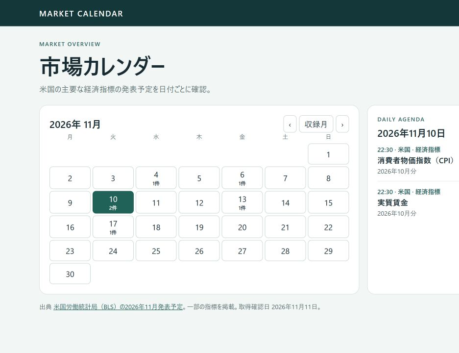

# MoomooAI 市場カレンダーデモ

米国の主要な経済指標、NYSEの休場日を月間カレンダーに表示します。日付や種類を選ぶと、発表時刻と出典を確認できます。



## 起動方法

リポジトリをダウンロードし、ブラウザで index.html を開きます。Python 3 がある場合は、以下で [ローカル画面](http://127.0.0.1:8000/) も開けます。

```sh
python -m http.server 8000 --bind 127.0.0.1
```

## データ更新

GitHub Actions が毎日 11:23 JST に今月・翌月のデータを取得します。Actions の「Refresh public market calendar」から手動実行もできます。取得エラー時は前回の公開データを保持します。ローカルで更新する場合は以下を実行します。

```sh
python -m pip install -r requirements.txt
python scripts/update_calendar.py
```

- 経済指標は [FRED](https://fred.stlouisfed.org/releases/calendar) のCPI、PPI、雇用統計、GDP、PCE、FOMC声明、JOLTSを収録。米国中部時間から日本時間へ換算します。
- 休場は [NYSE](https://www.nyse.com/trade/hours-calendars) の公表表から全日休場を取得し、取引所の現地日付で表示します。
- 決算予定・EPS予想・アナリスト推奨件数は、公開再配布を許諾する [Finnhub契約](https://api.finnhub.io/pricing-startups-and-enterprise) がある場合に利用できます。契約確認後、Actionsのシークレット FINNHUB_API_KEY と変数 ENABLE_LICENSED_DATA=true を設定します。対象は米国の主要7銘柄です。公開されるのは正規化したデータで、キーはActions内に保持されます。

公開対象は市場情報の取得と表示です。自動売買、発注、口座情報、本番システムへの接続は含みません。

市場ニュースでは [FRB公式RSS](https://www.federalreserve.gov/feeds/feeds.htm) の金融政策発表を、日付・見出し・原典リンクで毎日更新します。

[非公開版の表示項目と公開範囲](DISPLAY-INVENTORY.md)

決算予定は [Home Depot公式IR](https://ir.homedepot.com/events-and-presentations) の公表済みイベントから日付・時刻・出典リンクを毎日取得します。収録対象は現在Home Depotです。時刻は米国東部時間です。
